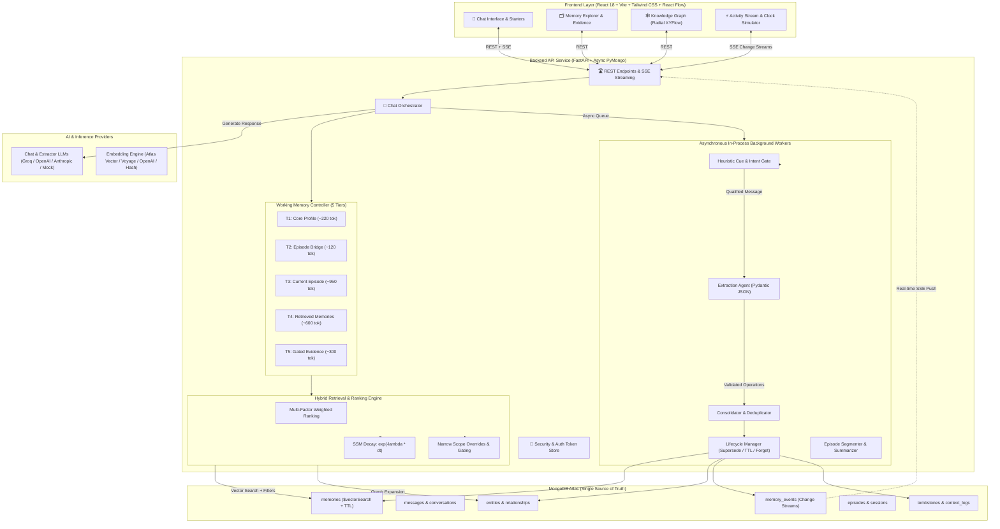

# MEMORA: Structured Persistent Memory Engine for AI Agents

[](https://www.python.org/)
[](https://fastapi.tiangolo.com/)
[](https://react.dev/)
[](https://www.mongodb.com/atlas)
[](https://www.typescriptlang.org/)
[](https://tailwindcss.com/)

**MEMORA** is an agentic persistent memory engine designed for AI assistants and tutors. Instead of naively resending massive chat histories on every turn, MEMORA extracts validated, typed memory documents, maintains an evolving knowledge graph, continuously decays and reinforces memory strength, resolves contextual conflicts, and enforces temporary expiry and privacy erasure—all backed by **MongoDB Atlas Vector Search** and **Change Streams**.

---

## The Problem MEMORA Solves

Standard conversational AI agents suffer from two fundamental memory flaws:
1. **Catastrophic Amnesia**: Agents forget goals, learning styles, difficulties, and constraints across sessions.
2. **Context-Window Exhaustion & Confusion**: Replaying raw conversation histories is expensive, introduces contradictory instructions, lacks scope resolution, and provides zero mechanism for auditability, expiry, or privacy redaction.

### What MEMORA Does
* **Separates Extraction from Answering**: A fast, asynchronous background extraction agent validates structured JSON memory operations without blocking the user response.
* **5-Tier Token-Budgeted Working Memory**: Replaces raw chat logs with a compact, high-signal context (Core Profile, Episode Bridge, Current Episode, Retrieved Memories, and Gated Evidence).
* **Multi-Factor Hybrid Retrieval**: Combines MongoDB Atlas `$vectorSearch`, knowledge graph expansion, temporal decay, and domain scope gating with explainable retrieval reasons.
* **Deterministic Lifecycle & Right to be Forgotten**: Supports create, merge, supersede (replacing obsolete memories), TTL expiration, and GDPR-compliant erasure with tombstoning and evidence redaction.
* **Continuous Temporal Decay & Hebbian Reinforcement**: Models memory retention mathematically ($s(t) = s_0 \cdot e^{-\lambda \Delta t}$), reinforcing memories whenever they are retrieved.
* **Interactive Knowledge Graph**: Maps entities and relationships into native MongoDB collections, visualized live with `@xyflow/react`.

---

## Architectural Diagram



---

## Detailed System Dataflow

1. **Turn Execution (Synchronous)**:
   - User sends a message via the React chat interface.
   - Message is embedded and stored in the `messages` collection.
   - The **Working Memory Controller** gathers the 5 tiers:
     1. **T1 Core Profile**: High-confidence preferences, goals, and constraints cached per session.
     2. **T2 Episode Bridge**: A 1-sentence contextual handoff carried over from the previous episode.
     3. **T3 Current Episode**: Rolling episode summary plus recent verbatim turns.
     4. **T4 Retrieved Memories**: Candidate selection via MongoDB Atlas `$vectorSearch`, filtered by user, workspace, and `status: active`, expanded through 1-hop knowledge graph traversal, and scored by composite relevance.
     5. **T5 Gated Evidence**: Verbatim excerpts from earlier conversations fetched via evidence pointers only when past context is explicitly queried.
   - Sanitized context is formatted under `<memory_context>` tags and sent to the LLM.
   - LLM generates a personalized response; assistant turn and tokens are stored; response is delivered immediately.

2. **Memory Extraction & Consolidation (Asynchronous Background)**:
   - The user never waits for extraction. The background worker evaluates candidate messages through a heuristic cue gate (e.g., first-person intent, preference, or goal markers).
   - Qualified messages pass to the **Extraction Agent**, which returns validated, typed memory operations with short-token references (`M1`, `M2`).
   - The **Consolidator** deduplicates (cosine similarity $\ge 0.93$), merges evidence, updates graph relationships, and triggers superseding transitions for contradictory statements in the same scope.
   - Events are written to `memory_events`, triggering MongoDB Atlas Change Streams that push live updates to the frontend via Server-Sent Events (SSE).

---

## Core Features & Capabilities

### 1. Typed Memory Architecture
Memories are not raw text blobs; they are typed, structured MongoDB documents:
* `preference`: Learning modalities, formatting choices, communication styles.
* `goal`: Objectives, target projects, target milestones.
* `learning_difficulty`: Conceptual hurdles, confusing topics.
* `constraint`: Deadlines, time allocations, exam dates.
* `strategy`: Techniques that proved effective for the user.
* `fact`, `feedback`, `decision`: Domain facts, feedback on answers, commitments.

### 2. Multi-Factor Scoring & Ranking
Retrieval combines semantic, cognitive, and structural metrics:
$$\text{Score} = w_{\text{sim}} S_{\text{sim}} + w_{\text{imp}} S_{\text{imp}} + w_{\text{conf}} S_{\text{conf}} + w_{\text{str}} S_{\text{str}}(t) + w_{\text{graph}} S_{\text{graph}} + w_{\text{scope}} S_{\text{scope}} + w_{\text{type}} S_{\text{type}}$$
* **Similarity ($S_{\text{sim}}$)**: Atlas Vector Search cosine score.
* **Strength Decay ($S_{\text{str}}(t)$)**: Continuous retention modeling: $s(t) = s_0 \cdot e^{-\lambda \Delta t}$.
* **Scope ($S_{\text{scope}}$)**: Topic-specific constraints (e.g. `topic:mathematics`) strictly override global defaults.
* **Graph ($S_{\text{graph}}$)**: Structural affinity from entity neighborhood traversal.

### 3. Dynamic Knowledge Graph
* First-class `entities` and `relationships` collections in MongoDB.
* Memory lineage: Every graph edge stores supporting `memory_ids`.
* Interactive radial visualization using `@xyflow/react` (React Flow).
* Historical view toggle: Superseded or replaced links can be viewed as dashed historical paths.

### 4. Deterministic Lifecycle & GDPR Erasure
* **Create & Merge**: Reinforces existing memories and appends evidence pointers.
* **Supersede**: When preferences change (e.g., from visual to code-first), the old memory is superseded, not destroyed, maintaining historical auditability.
* **TTL Expiration**: Temporary memories (e.g., *"Exam next Monday"*) expire automatically via MongoDB TTL indexes and real-time app-side filters.
* **Forget & Tombstone**: Redacts supporting message excerpts, purges graph edges, tombstones key terms to prevent re-extraction, and wipes sensitive event logs.

### 5. Multi-Provider AI Inference
* **LLM Engine**: Groq (ultra-fast inference), OpenAI, Anthropic, or an offline Mock provider.
* **Embedding Engine**: MongoDB Atlas Vector Search, Voyage AI, OpenAI, or a deterministic local Hash embedder (zero external API keys required).

---

## MongoDB Schema & Indexes

| Collection | Role & Purpose | Key Indexes |
|---|---|---|
| `users` | User accounts, demo clock offsets, memory version tags | `username` (unique), `created_at` |
| `conversations` | Grouping container for conversation episodes | `user_id + workspace_id`, `updated_at` |
| `messages` | Verbatim chat turns with embedding vectors & token counts | `conversation_id`, `expires_at` (TTL), `user_id` |
| `memories` | Typed persistent memory documents with evidence pointers | `memory_vector_index` (Vector Search), `user_id + status + scope`, `expires_at` (TTL) |
| `entities` | Named concepts, topics, skills, and tools | `user_id + workspace_id + norm` (unique) |
| `relationships` | Directed edges linking entities (e.g. `prefers`, `struggles_with`) | `user_id + workspace_id + source + relation + target` (unique) |
| `memory_events` | Append-only audit log powering Change Streams (SSE) | `user_id + workspace_id`, `created_at` |
| `episodes` | Segmented conversation blocks with rolling summaries | `episode_vector_index` (Vector Search), `conversation_id`, `expires_at` (TTL) |
| `sessions` | Ephemeral working memory state, cache keys, activation scores | `_id` |
| `tombstones` | Sanitized fingerprints of forgotten concepts preventing re-extraction | `user_id + workspace_id` |

---

## Local Installation & Setup

### Prerequisites
* Python 3.12+
* Node.js 20+ and npm
* A free [MongoDB Atlas Cluster](https://www.mongodb.com/cloud/atlas) (or local MongoDB container)

### 1. Clone & Configure Environment
```bash
git clone https://github.com/your-username/memora.git
cd memora
cp .env.example .env
```

Edit `.env` with your settings:
```ini
# Database (MongoDB Atlas)
MONGODB_URI=mongodb+srv://<user>:<password>@cluster0.mongodb.net/?retryWrites=true&w=majority
MONGODB_DB=memora
VECTOR_BACKEND=local

# LLM Provider (Groq, OpenAI, or Anthropic)
LLM_PROVIDER=openai
OPENAI_API_KEY=gsk_your_groq_api_key_here
OPENAI_BASE_URL=https://api.groq.com/openai/v1
CHAT_MODEL=openai/gpt-oss-120b
EXTRACTOR_MODEL=openai/gpt-oss-20b

# Embeddings (Hash for local/offline, Voyage, or OpenAI)
EMBEDDING_PROVIDER=hash
EMBEDDING_DIMENSIONS=256

# Auth & Security
AUTH_SECRET=generate_a_secure_random_string_here
```

### 2. Backend Setup
```powershell
# Create and activate virtual environment
python -m venv .venv
.\.venv\Scripts\Activate.ps1   # On Linux/macOS: source .venv/bin/activate

# Install dependencies
pip install -r backend/requirements-dev.txt

# Initialize collections, indexes, and seeded demo account
python scripts/setup_db.py

# Start FastAPI server
cd backend
uvicorn app.main:app --reload --port 8000
```
Backend API will be running at [http://localhost:8000](http://localhost:8000) (Interactive Swagger Docs at `/docs`).

### 3. Frontend Setup
In a new terminal window:
```powershell
cd frontend
npm install
npm run dev
```
Frontend interface will be running at [http://localhost:5173](http://localhost:5173).

---

## Production Cloud Deployment

### Architecture on Render
* **Backend**: Docker Web Service running FastAPI (`uvicorn app.main:app --workers 1`). Single worker ensures in-process memory queues avoid race conditions.
* **Frontend**: Render Static Site (zero cost, global CDN, instant deployments) with Vite SPA rewrites (`/* -> /index.html`).

#### Backend Service (Render Web Service)
1. In Render Dashboard, click **New +** → **Web Service** → Select your repo.
2. Settings:
   - **Root Directory**: `backend`
   - **Environment**: `Docker`
   - **Dockerfile Path**: `Dockerfile`
3. Environment Variables:
   - Set `MONGODB_URI`, `LLM_PROVIDER`, `OPENAI_API_KEY`, `OPENAI_BASE_URL`, `CHAT_MODEL`, `EXTRACTOR_MODEL`, `EMBEDDING_PROVIDER`, `AUTH_SECRET`, `PORT=8000`.
   - Set `CORS_ORIGINS=https://your-frontend.onrender.com,http://localhost:5173`.

#### Frontend Site (Render Static Site)
1. Click **New +** → **Static Site** → Select your repo.
2. Settings:
   - **Root Directory**: `frontend`
   - **Build Command**: `npm install && npm run build`
   - **Publish Directory**: `dist`
3. Environment Variables:
   - `VITE_API_BASE_URL`: `https://your-backend.onrender.com`
4. Under **Redirects/Rewrites**:
   - Add: `/*` → `/index.html` (Rewrite).

---

## Verification & Demo Scenarios

Log in with demo credentials (`demo` / `memora-demo`) and follow these validation scripts:

| # | Action | Verification & What to Inspect |
|---|---|---|
| **1** | **Learn Preference**<br>`"I prefer learning algorithms with visual examples."` | Header shows *"Updating memory"* → *"Memory updated"*. In **Memories** (`/memories`), a new `Preference` is active with high confidence and evidence pointers. In **Knowledge Graph** (`/graph`), a new edge links `You` to `visual examples`. |
| **2** | **Cross-Session Recall**<br>Click *+ New conversation* → `"Explain binary search."` | The answer is delivered using visual metaphors. Click **"Memories used: 1"** accordion under the response → click **"Show original messages"** to reveal the exact quote from session 1. |
| **3** | **Memory Evolution (Superseding)**<br>`"I no longer want visual explanations. Give me code-first explanations."` then `"Explain quicksort."` | The answer switches to pure code. In **Memories**, the old visual preference moves to the **Replaced** tab with an audit trail. In **Knowledge Graph**, check *"Show replaced links (dashed)"* to see the historical edge. |
| **4** | **Scope-Aware Overrides**<br>`"I prefer short explanations."`<br>`"For mathematics, I want detailed explanations."`<br>Ask: `"Explain the chain rule in calculus."` | The calculus answer is detailed. Under **Memories used**, the math preference is applied, while the short-explanation preference is listed as **"Not applied: (overridden by narrower scope)"**. |
| **5** | **Time Decay & Expiry (TTL)**<br>`"I have an exam next Monday."`<br>Use Clock Simulator (bottom left) to advance **+7 days** twice. | The toast shows *"1 temporary memory expired"*. Under **Memories**, the exam is in the **Expired** tab. Ask *"What should I study today?"* — the exam memory is ignored and no longer influences recommendations. |
| **6** | **Right to be Forgotten**<br>`"Forget that I struggle with recursion."` | In **Memories**, the item is moved to **Forgotten** with its content scrubbed. In **Knowledge Graph**, the `Recursion` node vanishes completely. In **Activity**, prior extraction events are redacted. |

---

## Testing & Quality Assurance

```powershell
# Run backend pytest suite (36 unit, lifecycle, ranking, and API tests)
cd backend
pytest -q

# Run frontend typecheck, vitest component tests, and production build
cd frontend
npm run typecheck
npm test
npm run build
```

---

## License

Built for the MongoDB Student Hackathon (Track 1: Agentic Memory) under the MIT License.
