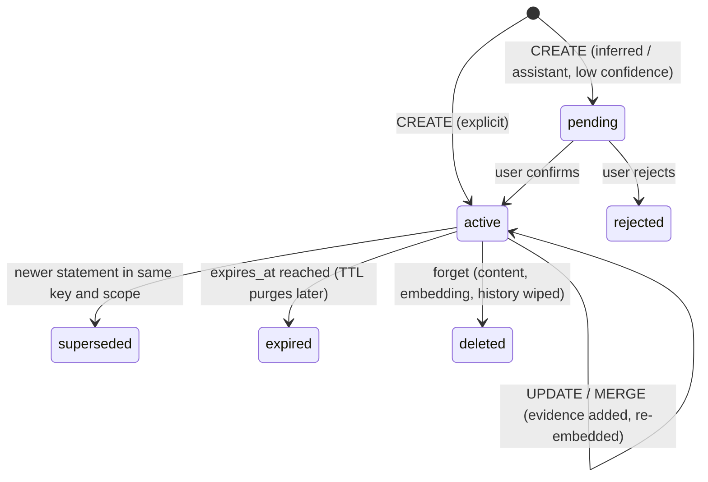

# MEMORA architecture

## Design decisions (from the research step)

| Decision | Why |
|---|---|
| PyMongo `AsyncMongoClient` | MongoDB's native async driver API; Motor is deprecated in its favour. |
| `$vectorSearch` with `filter` on `user_id`, `workspace_id`, `status` | Filter fields must be declared as `type: "filter"` in the Vector Search index. User isolation happens inside the search, not after it. |
| Score read with `{"$meta": "vectorSearchScore"}` | For cosine similarity Atlas reports a normalised 0..1 score; the local fallback maps cosine the same way, so thresholds are consistent. |
| Expiry checked in the app as well as by TTL | The TTL monitor runs about once a minute, so expired documents can still exist. |
| Memories as independent documents, graph as a separate layer | MongoDB stays the source of truth; every graph edge stores the `memory_ids` that support it, so updates and deletions propagate deterministically. Neo4j is not needed at this scale. |
| Two LLM operations | The main agent answers synchronously; extraction and consolidation run afterwards in the background, with a cheap gate so trivial messages never trigger an extraction call. |
| Structured output validated with Pydantic, model sees only short refs | The extractor references `M1..` (messages) and `E1..` (memories). The server maps refs to real ids and drops unknown ones, so a model cannot invent or inject ids. One repair attempt on invalid output. |
| Memories are data, never instructions | Memory text is sanitised and wrapped in `<memory_context>`, the system prompt states it is data, and instruction-like content is refused at write time. |
| In-process worker instead of Redis/Celery | One fewer service to host for a hackathon deployment; per-user locks avoid consolidation races. The runner is isolated so a queue can replace it. |

## Data model

| Collection | Key fields |
|---|---|
| `users` | username, password hash, workspaces, `memory_version` (invalidates session caches), `clock_offset_seconds` (demo clock), `state.h_slow` |
| `conversations` | user, workspace, title, `total_tokens` |
| `messages` | conversation, role, content, embedding (user turns), `episode_id`, `context` (assistant turns: memories used, tokens), optional `expires_at` |
| `memories` | `type`, `key` (slot), `content`, `scope` (`global` or `topic:<subject>`), `confidence`, `importance`, `origin` (explicit/inferred/assistant), `source` + `evidence_message_ids`, `status` (active/superseded/expired/deleted/rejected), `confirmation`, `temporary`, `expires_at`, `strength`, `decay_lambda`, `last_reinforced_at`, `supersedes`/`superseded_by`, `history[]`, `entity_ids`, `embedding` |
| `entities` | name, normalised name (unique per user and workspace), kind, `memory_ids` |
| `relationships` | source, relation, target (unique), `status` (active/superseded), `memory_ids` |
| `memory_events` | action, reason, memory ids, content preview (redacted after forget), timestamp |
| `episodes` | conversation, status (open/closing/closed), message ids, centroid, subjects, rolling summary, summary, outcome, `consolidated_into`, embedding, decay fields, `expires_at` |
| `sessions` | working-memory state per conversation: cached core-profile ids and version, working-memory items with activations, bridge, `h_fast`, pending extraction batch |
| `context_logs` | tokens per tier per turn, boundary scores, evictions, evidence gate |
| `tombstones` | type and key terms of forgotten memories (blocks re-extraction from old messages) |

Indexes are listed in `backend/app/database/indexes.py`. Regular and TTL indexes are created at startup;
Vector Search indexes are created by `scripts/setup_db.py` or manually from `scripts/atlas_vector_indexes.json`.

## Memory lifecycle


- **Duplicates** (normalised similarity ≥ 0.93, or same slot with near-identical wording) reinforce the existing memory and merge evidence.
- **Conflicts** in the same `key` and `scope` supersede the old memory, which stays in history. Different scopes coexist, and a temporary statement never overwrites a lasting preference.
- **Forget** tombstones the memory, removes graph edges and orphan entities, redacts prior events, redacts supporting messages and episode summaries (`FORGET_REDACTS_EVIDENCE`), and forgets other active memories that contain the same information. A fresh explicit statement after the forget request is allowed.
- **Secrets and instruction-like content** are never stored (an event records that something was blocked, without the content).

## Retrieval workflow

1. Embed the message; update a fast (episode) and slow (user) state vector; query vector = `normalize(e + 0.3·h_fast + 0.1·h_slow)`.
2. `$vectorSearch` on `memories` filtered by user, workspace and `status: active`.
3. Graph expansion: entities named in the message, plus one hop, add their memories.
4. Drop expired or rejected memories, and topic-scoped memories for other topics.
5. Rank: `0.40·similarity + 0.15·importance + 0.10·confidence + 0.15·strength(t) + 0.05·type + 0.10·graph + 0.05·scope` (weights configurable), with a relevance gate.
6. Resolve scope overrides: a matching topic-scoped memory hides the global memory with the same key.
7. Explain each result (semantic match, graph path, scope, strength, pinned status).

`strength(t) = strength · exp(-lambda · Δt_days)`, where `lambda = ln 2 / half_life(type) / (0.5 + importance)`, evaluated lazily at read time; each use reinforces it (`s ← s + 0.25·(1 − s)`).

## Working memory per turn

| Tier | Contents | Budget (tokens) |
|---|---|---|
| T1 core profile | High-confidence preferences, goals, constraints, strategies; cached per session and invalidated when `memory_version` changes | 220 |
| T2 bridge | One-line handoff from the previous episode, kept for 3 turns | 120 |
| T3 episode | Rolling summary plus recent verbatim turns of the current episode only | 250 + 700 |
| T4 memories | Delta retrieval (excludes items already loaded); existing items re-scored; activation `a ← 0.7a + 0.3r`, evicted below 0.15; packed by value per token | 600 |
| T5 evidence | Closed-episode summaries and original user messages via pointers, only when the question refers to the past or a memory has low confidence | 300 |

**Episode boundaries:** `score = 0.5·topic_shift + 0.3·time_gap + 0.2·cue`. Switch at 0.55, a soft boundary at 0.42 must be confirmed by the next turn, a minimum of 2 turns per episode, and an explicit cue ("anyway, new topic") switches immediately. On a switch the episode is closed and summarised in the background, consolidated (linked to the memories it produced), and the episode tiers are reset.

## Background processing

```
POST message ─► store user message ─► build working memory ─► main agent reply ─► store reply ─► respond
                                                                                     │
          (after the response, per-user lock, retries with backoff)                  ▼
          extraction gate ─► extraction agent ─► validate ─► consolidator ─► lifecycle + graph + events
          episode switch  ─► summarise closed episode ─► embed ─► link consolidated memories
          long episode    ─► rolling summary of turns outside the verbatim window
```
The frontend polls `/api/system/jobs` after a message and shows "Updating memory" until jobs finish.
